# Data model

Status: draft for S1. Every rule in the last column of the table is enforced in Postgres (constraint, trigger or RLS policy), not only in the UI, and each has an automated test (see [traceability](traceability.md)).

## Entity diagram

```mermaid
erDiagram
    PROPERTY ||--o{ UNIT : has
    UNIT ||--o{ LEASE : "leased by"
    TENANT ||--o{ LEASE : signs
    LEASE ||--o{ LEASE_RENT_SCHEDULE : "rent over time"
    LEASE ||--o{ CHARGE : owes
    CHARGE ||--o{ CHARGE_ADJUSTMENT : "corrected by"
    LEASE ||--o{ PAYMENT : receives
    PAYMENT ||--o| PAYMENT_REVERSAL : "may be reversed by"
    PAYMENT ||--o{ PAYMENT_ALLOCATION : "split into"
    CHARGE ||--o{ PAYMENT_ALLOCATION : "paid by"
    LEASE ||--o{ DEPOSIT : holds
    LEASE ||--o{ DEPOSIT_DEDUCTION : "withheld from deposit"
    LEASE ||--o| REFUND : "settled by"
    LEASE |o--o| LEASE : "renewed from"
```



## Tables

All tables have `id uuid`, `owner_id uuid default auth.uid()`, `created_at`, `created_by`. Money columns end in `_cents` and are `bigint` (D-02).

| Table | Key fields | Rule that removes a risk | Req |
| --- | --- | --- | --- |
| `properties` | name, address, archived_at | RLS: `owner_id = auth.uid()` on every table | FR-02 |
| `units` | property_id, label, archived_at | `UNIQUE (property_id, label)`; can't archive with an active lease | FR-03 |
| `tenants` | full_name, email, phone, archived_at | `CHECK (email IS NOT NULL OR phone IS NOT NULL)` | FR-04 |
| `leases` | unit_id, tenant_id, start_date, end_date, due_day, status, move_out_date, renewed_from_id, deposit_waived_at, deposit_waiver_reason | `CHECK (end_date > start_date)`; `due_day BETWEEN 1 AND 28`; exclusion constraint: no two active leases on one unit with overlapping dates; trigger: can't set `active` without a deposit row or waiver | FR-05, FR-06 |
| `lease_rent_schedule` | lease_id, effective_period, monthly_rent_cents | `UNIQUE (lease_id, effective_period)`; can't add a row for a period already charged | FR-07 |
| `charges` | lease_id, kind (`rent`, `deposit_shortfall`), period, amount_cents, due_date | Partial unique index `(lease_id, period) WHERE kind = 'rent'` makes duplicate rent impossible; `amount_cents > 0` | FR-08, FR-16 |
| `charge_adjustments` | charge_id, amount_cents (±), reason | Proration on move-out adds a negative adjustment; the charge row itself is never edited | FR-17, NFR-02 |
| `payments` | lease_id, amount_cents, paid_on, method (`bank_transfer`, `cash`, `cheque`, `card`, `other`), reference | Unique index on `(lease_id, lower(btrim(reference)))` where a reference is given stops double entry, so "TRX-881" and "trx-881 " collide (D-24); `amount_cents > 0`; only on active or ended leases | FR-10 |
| `payment_reversals` | payment_id (unique), reason, reversed_on | One reversal per payment; reversing releases its allocations | FR-13 |
| `payment_allocations` | payment_id, charge_id, amount_cents (±) | Trigger: net allocations to a charge ≤ its adjusted amount, and net allocations from a payment ≤ the payment. Negative rows release money back to credit | FR-11, FR-12 |
| `deposits` | lease_id, amount_cents, received_on | One row per instalment; deposit held = sum | FR-14 |
| `deposit_deductions` | lease_id, amount_cents, reason | `reason` NOT NULL and not blank | FR-15 |
| `refunds` | lease_id (unique), amount_cents, status, paid_on | Trigger: `amount_cents = max(0, deposits − deductions)`; excess becomes a `deposit_shortfall` charge | FR-16 |

**Append-only.** `charges`, `charge_adjustments`, `payments`, `payment_reversals`, `payment_allocations`, `deposits` and `deposit_deductions` have no `UPDATE` or `DELETE` policy, and a trigger rejects both (NFR-02). Mistakes are fixed with an adjustment, reversal or negative allocation.

## Derived views

Nothing below is stored. Each is a SQL view so the numbers can't drift from the ledger (NFR-04).

| View | Returns | Used by |
| --- | --- | --- |
| `lease_deposit_summary` | per lease: deposits received, deposit held | Lease page (US-17) |
| `charge_balances` | per charge: amount, adjustments, value (amount + adjustments), allocated, balance, status (`open`, `partial`, `paid`, or `cancelled` when adjustments bring the value to 0) | Lease page, reports |
| `payment_balances` | per payment: amount, value (0 once reversed), allocated, unallocated | Credit, auto-apply |
| `lease_credit` | per lease: payments not reversed − net allocations | Ledger, credit auto-apply |
| `lease_ledger` | charges, adjustments, payments, reversals in date order with a running balance (positive = tenant owes). Allocation rows show where each payment went ("Applied to…", "Credit applied to…") and don't move the balance | US-16 |
| `overdue_rent` | charges past due with balance > 0, days overdue | US-20 |
| `pending_refunds` | ended leases with refund status ≠ `paid`, days since end | US-21 |

## Money rules, worked

| Rule | Formula | Example |
| --- | --- | --- |
| Monthly rent for a period | latest `lease_rent_schedule` row with `effective_period ≤ period` | 1,200.00 until 2026-12, 1,250.00 from 2027-01 |
| Proration (D-04) | rent × days occupied ÷ days in month, rounded half-up to the cent | Move-in 2026-11-16: 1,200.00 × 15 ÷ 30 = 600.00 |
| Early move-out | adjustment = prorated amount − original charge | Out 2027-02-10: 428.57 − 1,200.00 = −771.43 |
| Default allocation (D-07) | oldest open charge first, by due date | 700.00 against Nov 200.00 + Dec 1,200.00 → 200.00 / 500.00 |
| Credit | Σ payments not reversed − Σ net allocations | 1,500.00 paid, 1,200.00 allocated → 300.00 credit |
| Refund | max(0, Σ deposits − Σ deductions) | 1,200.00 − 150.00 = 1,050.00 |
| Deposit shortfall | max(0, Σ deductions − Σ deposits) as a charge | 1,400.00 − 1,200.00 = 200.00 owed |

## Charge generation (idempotent)

```sql
insert into charges (lease_id, kind, period, amount_cents, due_date)
select …  -- every active lease covering :period
on conflict (lease_id, period) where kind = 'rent' do nothing;
```

Running it twice, or twice at the same moment, creates each charge once (US-10 AC2, AC3). The amount comes from `prorate_cents(rent, occupied_days, days_in_month)`, the only proration code in the system, and the description of a prorated charge says how many days it covers.
